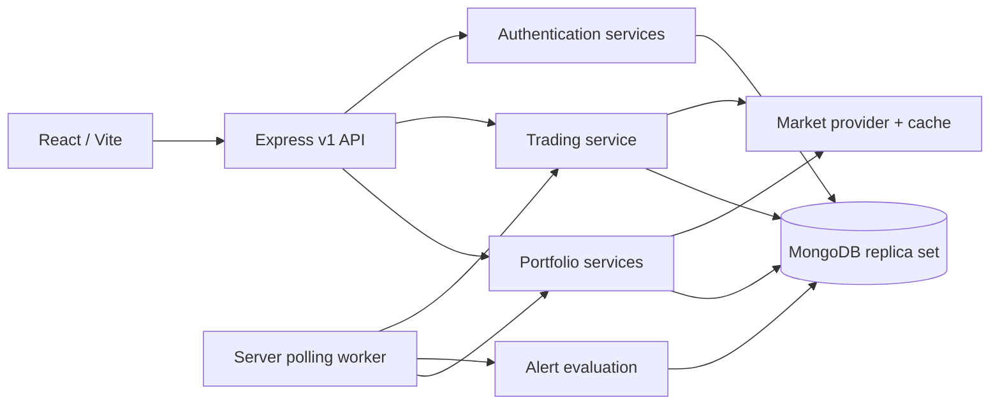

# TradeX

**Your edge starts with practice.** A full-stack Indian stock paper trading and portfolio workspace built with MongoDB, Express, React and Node.js.

TradeX starts every account with **₹10,00,000 in virtual capital**. Search stocks, place market or limit orders, track weighted-average holdings, and measure performance in a dark, responsive workspace. Account balances, positions, histories, watchlists and alerts come from the backend and MongoDB. New accounts have no prefilled holdings.

**Paper trading only.** No real-money payments, deposits, withdrawals, broker connectivity or exchange execution. TradeX is not a licensed brokerage or financial advisory service. The included provider generates **simulated prices**, prominently labeled throughout the application.

## Features

- Registration/login, bcrypt password hashes, protected API routes, in-memory access tokens, rotating HTTP-only refresh cookies, hashed sessions, refresh-family replay revocation and logout.
- Searchable catalogue of 16 Indian stocks using normalized `SYMBOL.NSE` identifiers. Timestamped synthetic quotes, daily changes, synthetic OHLC history and interactive area/candlestick charts.
- Market and limit orders, idempotent submissions, conditional account/holding updates and multi-collection MongoDB transactions.
- Cash, invested cost basis, current valuation, equity, realized/unrealized P&L, individual performance and sector/cash allocation.
- Genuine observed portfolio snapshots; no fabricated historical portfolio returns.
- Private deduplicated watchlist, sortable/paginated order and transaction histories, IST date filters, order details and safe pending-order cancellation.
- Server-side limit-order polling, one-time price alerts and private in-app notifications with read state.
- Desktop sidebar, mobile navigation, skeletons, empty/error states, accessible native forms, modal trade ticket and global stock search (`Ctrl/Cmd+K`).
- Environment examples, health check, Vercel/Render configurations and CI.

## Quick start

Requires **Node.js 22.12+** and npm. Verified here with Node 24.13.1.

```sh
npm install
npm run dev
```

Open **http://127.0.0.1:5173**, select **Create an account**, and register with a password of at least 10 characters. There are no shared demo credentials. Every user gets a private virtual wallet.

`npm run dev` starts the entire stack and waits for the API/database before starting Vite. With no configured database URI it downloads an official MongoDB binary on first run (the Windows download is approximately 600 MB) and starts a persistent single-node replica set on `127.0.0.1:27018`. It reuses an already-running healthy API or TradeX frontend and refuses conflicting ports instead of silently switching the website to another port. The database is retained in `backend/.data/mongodb`; API watching does not restart MongoDB. Use `npm run dev:local` to force the local database, `LOCAL_MONGO_PORT` to change its port, or `npm run dev:external` for an already-configured Atlas/replica-set URI. Development signing secrets are generated in memory unless supplied in `.env`; restarting the entire local launcher invalidates existing sessions when using ephemeral secrets. Keep this command running while using the website; `Ctrl+C` stops its services.

For MongoDB Atlas or an existing replica set:

```powershell
Copy-Item backend/.env.example backend/.env
# Edit the database URI and both signing secrets in backend/.env.
npm run dev
```

Generate each independent secret with `node -e "console.log(require('node:crypto').randomBytes(48).toString('hex'))"`. Never commit `.env`. A standalone MongoDB instance is rejected at startup because it cannot provide the transactions used by this trading engine.

## Architecture



```text
frontend/src/
  components/   reusable states, charts, activity and trade dialog
  layouts/      responsive workspace navigation and search
  pages/        auth, markets, portfolio, analytics, trading and account pages
  hooks/        TanStack Query queries and mutations
  services/     Axios client, memory-only bearer auth, single-flight refresh
  store/        Zustand session state
  utils/        INR/percentage/time formatting
backend/src/
  config/       validated environment and replica-set connection
  controllers/  HTTP request/response adapters
  routes/       versioned REST routing
  middlewares/  authentication, origin/CSRF checks and error handling
  models/       indexed Mongoose schemas
  services/     authentication, market, trading and account business logic
  jobs/         background market/alert/snapshot polling
  validators/   strict Zod request schemas
  utils/        errors and integer cost allocation
```

Frontend: React 19, Vite 7, React Router 7, Tailwind 4 plus component CSS, Axios, TanStack Query, Zustand, Recharts, TradingView Lightweight Charts, Lucide, React Hook Form, Zod and Sonner. Backend: Express 5, Mongoose 8, JWT, bcrypt, cookie-parser, CORS, Helmet, express-rate-limit and dotenv. Exact resolved versions are in `package-lock.json`.

## Trading engine and accounting

All API and stored monetary amounts are **integer paise** (`150000` means ₹1,500). Share quantities are positive integers. Monetary integers are restricted to JavaScript’s exact safe-integer range. Average purchase price is derived from remaining integer `costBasis / quantity`, rather than repeatedly rounding and storing an average.

`backend/src/services/trading.service.js` is the only wallet/holding mutation path. A trade obtains a server-owned eligible quote and runs one MongoDB transaction. It writes the user document first to serialize competing decisions, checks cash/quantity, conditionally updates resources, updates the holding, inserts a unique transaction and marks the order filled. Database errors roll back every financial change. MongoDB’s transaction callback handles transient-error retries. Quote freshness is checked before submission and again before the fill.

Every submission requires an **`Idempotency-Key`** header (8–128 alphanumeric, underscore or hyphen characters; a UUID works). `(userId, idempotencyKey)` is unique. Retrying an identical accepted request returns the same order; reusing its key with different order fields returns HTTP 409. Failed requests that never commit an order do not consume a key. Keep the same key across network retries. Immediate invalid or underfunded market submissions return an error without writing a rejected order; pending limits that lose resources are persisted as `REJECTED`.

Weighted-average selling allocates remaining cost in proportion to the shares sold using **BigInt arithmetic, rounded half up to the nearest paise**. Selling the final shares consumes the exact residual cost. Realized P&L is sale proceeds minus allocated cost. Fees are explicitly zero in this simplified simulation.

```text
Holding value    = shares × latest simulated price
Unrealized P&L   = holding value − remaining cost basis
Account equity   = virtual cash + all holding values
Total P&L        = account equity − initial virtual capital
Total return (%) = total P&L / ₹10,00,000 × 100
```

With no cash flows, fees, dividends or corporate actions, total P&L equals realized plus unrealized P&L. Valuations carry quote timestamps and stale flags. The overview and analytics chart use initial and 15-minute observed snapshots, up to the most recent 300. An empty/short account history stays empty/short; market history is separately labeled synthetic stock history.

### Limit orders and alerts

The simplified worker polls every 15 seconds while the API process is running. A buy limit is eligible at or below its limit, a sell limit at or above. Eligible orders fill their entire quantity at the available server quote. **No funds or shares are reserved.** Resources are checked at submission and revalidated at fill; otherwise the order becomes rejected. Cancellation and filling serialize on the same account, preventing a cancelled order from filling afterward.

This is not an exchange order book: no bid/ask spread, slippage, partial fills, exchange hours, priority, liquidity modeling or guaranteed execution. The simulation runs outside real exchange hours as well. Pending orders and alerts are durable in MongoDB and resume after restart. Multiple API instances can evaluate them safely because fills and alert-notification creation are transactional and unique. One process avoids overlapping polling cycles. Large installations should move polling to a dedicated monitored queue/worker; the current worker scans eligible records sequentially.

Alerts are one-time server evaluations. Marking an alert triggered and creating its notification share a transaction. API outages, invalid or stale quotes leave the alert/order pending for a future eligible update. Set `WORKER_ENABLED=false` to explicitly disable new automatic limits and alerts. The UI and API expose this limitation. Existing pending work resumes only if the worker is enabled again. No email/push notification service is implied.

## Database design

| Collection   | Important fields and constraints                                                                                   |
| ------------ | ------------------------------------------------------------------------------------------------------------------ |
| User         | unique normalized email, hidden password hash, integer virtual balance, account mutation version                   |
| TokenSession | unique refresh-token hash, family ID, revocation time, expiry TTL index                                            |
| Holding      | unique `(userId, symbol)`, quantity, remaining integer cost basis                                                  |
| Order        | unique `(userId, idempotencyKey)`, request hash, market/limit, pending/filled/cancelled/rejected, quote provenance |
| Transaction  | unique order ID, quantity, execution price, allocated basis, realized P&L and timestamp                            |
| Watchlist    | one default private list per user, deduplicated symbols, up to 50 stocks                                           |
| PriceAlert   | user, normalized symbol, GTE/LTE, target, active/triggered state                                                   |
| Notification | owner, unique alert ID, message and read time                                                                      |
| Snapshot     | unique `(userId, bucket)`, observed cash/holdings/equity, source and valuation timestamp                           |

Indexes initialize before the API starts. Tests use real isolated replica-set transactions, not a map or mock database.

## Market data

The shipped `SimulatedProvider` implements search, quotes and daily OHLC history. All prices and volumes are synthetic, not live, delayed exchange data or actual historical prices. No API key is required. Quotes refresh on 15-second simulation steps and have a five-second server cache; executable quotes older than `MAX_QUOTE_AGE_MS` (default two minutes), invalid prices and provider outages are rejected. The app never silently switches a real-data account to synthetic quotes.

Provider evaluation and the contract for adding an appropriately licensed Indian-data adapter are documented in [docs/MARKET_DATA.md](docs/MARKET_DATA.md). No external provider has been activated or claimed as verified NSE integration.

## API

Base path: `/api/v1`. Success: `{ "success": true, "data": ... }`. Errors: `{ "success": false, "error": { "code": "…", "message": "…" } }`. Use `Authorization: Bearer <accessToken>` for private endpoints. Refresh tokens are sent via HTTP-only cookies, never in JSON or localStorage.

| Method     | Endpoint                                                    | Behavior                                             |
| ---------- | ----------------------------------------------------------- | ---------------------------------------------------- |
| POST       | `/auth/register`, `/auth/login`                             | issue access token and refresh cookie                |
| POST       | `/auth/refresh`, `/auth/logout`                             | rotate/revoke refresh family                         |
| GET        | `/auth/me`                                                  | current private account                              |
| PATCH      | `/auth/profile`                                             | update full name only                                |
| GET        | `/stocks`, `/stocks/search?q=`                              | quote catalogue / company-symbol search              |
| GET        | `/stocks/:symbol`, `/stocks/:symbol/history?range=1M`       | quote / OHLC; ranges 1W, 1M, 3M, 6M, 1Y              |
| POST       | `/orders`, `/trades/buy`, `/trades/sell`                    | submit an idempotent virtual order                   |
| GET        | `/orders`, `/orders/:id`                                    | own order history / details                          |
| DELETE     | `/orders/:id`                                               | cancel an own pending order                          |
| GET        | `/portfolio`, `/portfolio/holdings`, `/portfolio/analytics` | own valuations and snapshots                         |
| GET        | `/transactions`                                             | own filled-trade ledger                              |
| GET / POST | `/watchlist`                                                | own list / add `{symbol}`                            |
| DELETE     | `/watchlist/:symbol`                                        | remove own list entry                                |
| GET / POST | `/alerts`                                                   | own alerts / create `{symbol,condition,targetPrice}` |
| DELETE     | `/alerts/:id`                                               | remove own alert                                     |
| GET        | `/notifications`                                            | own latest 100 notifications                         |
| PATCH      | `/notifications/:id/read`                                   | mark own notification read                           |
| GET        | `/config`                                                   | public simulation/worker capabilities                |

`GET /api/health` returns 200 when MongoDB is connected, otherwise 503. Orders/transactions accept `page`, `limit` (1–100), `side`, `symbol`, `sort=asc|desc`, `from=YYYY-MM-DD`, `to=YYYY-MM-DD`; orders also accept `status`. Date filters represent complete India Standard Time days. Pagination includes `items`, `total`, `page`, `limit` and `totalPages`.

Example order body (never include an execution price, balance or user ID):

```json
{ "symbol": "RELIANCE.NSE", "side": "BUY", "quantity": 5, "orderType": "MARKET" }
```

For a limit add `"orderType":"LIMIT","limitPrice":150000`. Create an alert with `{"symbol":"RELIANCE.NSE","condition":"GTE","targetPrice":160000}`.

## Configuration

| Variable                                  | Purpose                                                                               |
| ----------------------------------------- | ------------------------------------------------------------------------------------- |
| `MONGODB_URI`                             | Atlas / replica-set connection string; backend only                                   |
| `JWT_ACCESS_SECRET`, `JWT_REFRESH_SECRET` | separate random secrets, at least 32 characters                                       |
| `CLIENT_ORIGINS`                          | exact comma-separated allowed frontend origins                                        |
| `PORT`                                    | API port; hosting platform can supply it                                              |
| `NODE_ENV`                                | development/test/production                                                           |
| `COOKIE_SECURE`                           | false locally over HTTP, true in production                                           |
| `COOKIE_SAME_SITE`                        | lax locally; none for cross-site Vercel/Render cookies (requires secure)              |
| `TRUST_PROXY`                             | 0 locally; 1 for the documented single Render proxy                                   |
| `MARKET_PROVIDER`                         | currently `simulated` only; unknown providers fail startup                            |
| `MAX_QUOTE_AGE_MS`                        | maximum executable quote age                                                          |
| `WORKER_ENABLED`, `WORKER_INTERVAL_MS`    | enable polling / interval in milliseconds                                             |
| `VITE_API_URL`                            | frontend build-time full API base URL including `/api/v1`; empty for local Vite proxy |

Vite exposes `VITE_*` variables publicly; never put secrets there. Production refuses insecure cookies and example signing secrets. CORS permits exact configured origins; mutation origin/fetch-metadata checks reject untrusted cross-site cookie requests. Private operations additionally require in-memory bearer tokens. Access tokens expire after 10 minutes; refresh sessions after seven days. Logout/reuse revokes refresh sessions; already-issued access tokens remain valid until their short expiry. Rate limits are process-local; use a shared limiter store when scaling horizontally.

## Tests and verification

If the website reports that it cannot reach the API, run `npm run dev` from the repository root and leave that process running. Starting Vite alone runs only the frontend. The default launcher now starts MongoDB/API first, verifies both direct and proxied readiness, and reuses an existing TradeX frontend. The website retries a temporary outage automatically; it does not clear a valid session because of a network failure.

```sh
npm test          # deterministic backend tests against temporary real MongoDB replica sets
npm run check     # backend syntax check + Vite production build
npm run smoke     # running local Vite → API → DB workflow, including the real polling worker
npm run format    # format source and docs
```

Trading tests use an injected deterministic quote provider and never fetch live prices. The suite covers auth, authorization, refresh replay, buys/sells, insufficient funds, overselling, integer cost/P&L, concurrent trades, duplicate orders, database rollback and retry, portfolio identities, data isolation, watchlists, pagination, cancellation races, one-time alerts and disabled-worker behavior.

The smoke script creates a disposable QA account in your **local development database**, performs actual virtual trades, and leaves that account for inspection without printing credentials. It waits up to 45 seconds for a real background alert notification. It does not clear or reset existing accounts.

See [docs/VERIFICATION.md](docs/VERIFICATION.md) for executed checks and remaining visual verification limits.

## Deployment

For the simplest free demonstration, see [Free Render + Atlas deployment](docs/FREE_DEPLOYMENT.md). `render.free.yaml` serves React and the API together on one origin with the sleeping-host worker disabled. `npm run verify:deployment` checks this production entry point against an isolated database. The app's public name is TradeX; legacy local storage and token identifiers remain compatible so the rebrand does not reset existing accounts.

See [docs/DEPLOYMENT.md](docs/DEPLOYMENT.md) for Vercel frontend, Render backend, Atlas database, exact commands, cookies, origin setup and deployment validation. `frontend/vercel.json` supplies SPA deep linking and `render.yaml` supplies API health/environment configuration. Deployment requires your own hosting/database accounts and secrets; nothing has been published by this implementation.

## Screenshots

The app includes overview, markets/stock detail, portfolio, trade, watchlist, orders, transactions, analytics, alerts and account settings views. No fabricated screenshots or stock portfolio mockups are included. Browser access was unavailable in the implementation environment; capture the running overview and a stock/trade view after completing the manual visual checks in the verification document.

## Known limitations

- Synthetic catalogue/provider only. Licensed external NSE/BSE integration needs independently verified coverage, permissions and credentials.
- No brokerage integration, corporate actions, tax/fee simulation, dividends, fractional shares, leverage or short selling.
- Limit execution is a simplified full-fill polling model with resource revalidation and no reservation.
- Snapshot history is observational and capped to the most recent 300 returned points, not an exchange-grade tick history or historical reconstruction.
- One default watchlist per account. Notifications are in-app only. No email verification, password recovery or MFA service is included.
- Sleeping/stopped API hosting cannot evaluate orders/alerts or capture snapshots; it resumes on restart and cannot replay missed prices. Set the worker flag off if an always-running process is unavailable.
- Production deployment and browser visual/mobile QA require access outside the verification performed here. This project demonstrates production-style architecture; deployment readiness still requires your configured infrastructure and operational review.

TradingView Lightweight Charts is used with its attribution logo and a link to [TradingView](https://www.tradingview.com/). Other dependencies retain their respective licenses.
